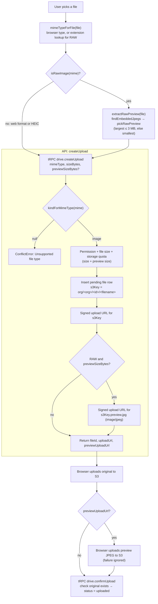
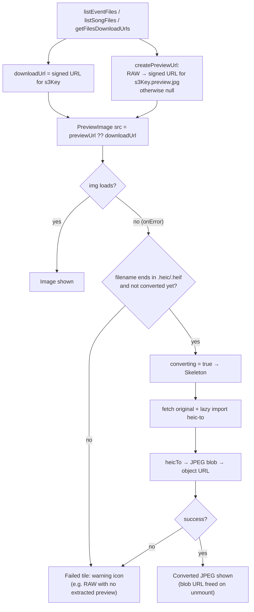
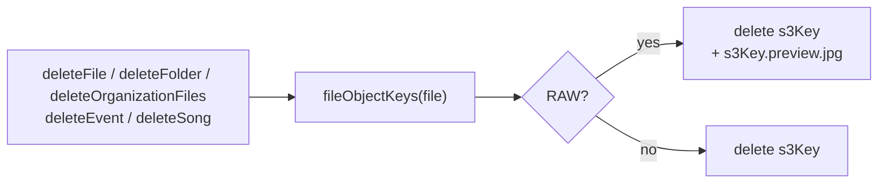

# Drive: file handling

Files live in S3 under `org/<organizationId>/<fileId>/<filename>` (`s3Key`). The database row holds the metadata, and the bytes never pass through the API: the browser uploads to and downloads from S3 with signed URLs.

Image formats fall into three groups:

| Group | Formats | How it's previewed |
|---|---|---|
| Web | PNG, JPEG, WebP, GIF, AVIF, BMP, SVG | The browser renders the original |
| HEIC | HEIC, HEIF | Safari renders the original; other browsers convert it to JPEG with `heic-to` when viewed |
| Camera RAW | DNG, CR2, CR3, NEF, ARW, RAF, ORF, RW2 | The camera's embedded JPEG is extracted at upload and stored at `<s3Key>.preview.jpg` |

Accepted mime types and the RAW helpers (`isRawImage`, `previewKeyFor`, `fileObjectKeys`, `mimeTypeForFile`) live in [`domain/index.ts`](./domain/index.ts).

## Upload

- Browsers often report an empty or vendor-specific type for RAW files, so `mimeTypeForFile` falls back to the file extension.
- RAW extraction runs in the browser (`apps/web/src/lib/file.ts`) because the file is already in memory there. The preview upload is best effort: if it fails, the RAW file still uploads and its tile shows the failed-load icon.
- The preview's size counts toward the quota check, but not toward stored usage, which comes from the original's size in S3.

## Display (gallery grid and carousel)

- `PreviewImage` is in `apps/web/src/components/ui/preview-image.tsx`.
- Download buttons always use `downloadUrl`, so users get the original file, never the preview.
- HEIC conversion is triggered by the filename (`/\.hei[cf]$/i`), not the mime type.

## Delete

The preview's location is computed from `s3Key` and the mime type, never stored in the database. Any code that deletes S3 objects must go through `fileObjectKeys` so previews aren't left behind.
